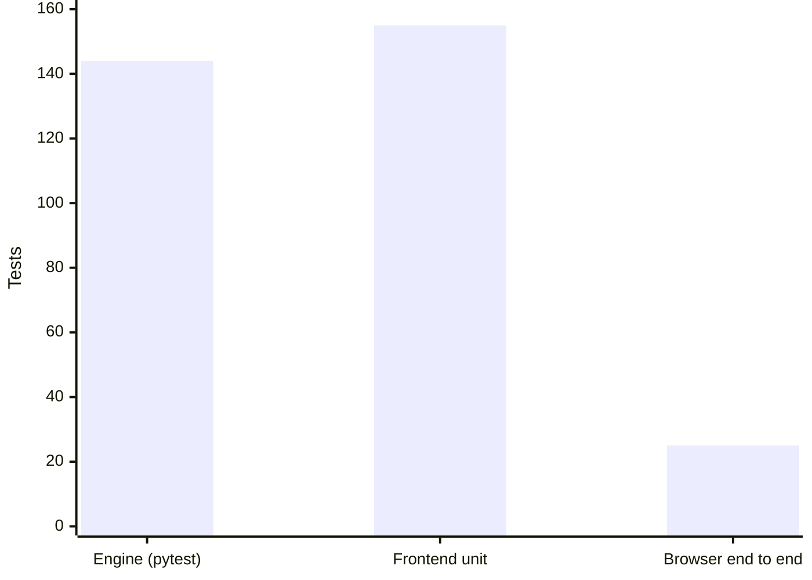

# Can optical clocks find buried mass? {#clock-gravity-study}

The Atomic Gravity Simulator now runs end to end and matches published experiments (9 of 9 checks). Its new result is that a gravimeter on the same stations is **690 to 13 000 times more sensitive** than the clock.

- Clocks would need about 10⁻²¹ per station before a joint clock and gravimeter survey improves the depth estimate.[](source:bondarescu2012)
- The best laboratory clocks today reach about 8 × 10⁻¹⁹, so the gap is roughly a factor of 1000.[](source:mehlstaubler2018)
- The engine reproduces the Tokyo Skytree redshift within 0.07σ of the geodetic value.[](source:takamoto2020)
- All 144 engine tests, 155 frontend tests and 25 browser tests pass.

@answer scope="Five built-in scenarios · first body as a point source · field gravimeter 5 µGal per station · 1 cm station heights"
@meta locale=en style=editorial
@source bondarescu2012 title="Bondarescu et al. 2012, Geophysical applicability of atomic clocks: direct continental geoid mapping, Geophys. J. Int. 191, 78-82" url=https://doi.org/10.1111/j.1365-246X.2012.05636.x
@source bondarescu2015 title="Bondarescu et al. 2015, Ground-based optical atomic clocks as a tool to monitor vertical surface motion, Geophys. J. Int. 202" url=https://doi.org/10.1093/gji/ggv246
@source lion2017 title="Lion et al. 2017, Determination of a high spatial resolution geopotential model using atomic clock comparisons, J. Geodesy" url=https://doi.org/10.1007/s00190-016-0986-6
@source mehlstaubler2018 title="Mehlstäubler et al. 2018, Atomic clocks for geodesy, Rep. Prog. Phys. 81, 064401" url=https://doi.org/10.1088/1361-6633/aab409
@source delva title="Delva, Denker and Lion, Chronometric geodesy: methods and applications (arXiv:1804.09506)" url=https://arxiv.org/abs/1804.09506
@source grotti2018 title="Grotti et al. 2018, Geodesy and metrology with a transportable optical clock, Nature Physics 14, 437-441" url=https://doi.org/10.1038/s41567-017-0042-3
@source takamoto2020 title="Takamoto et al. 2020, Test of general relativity by a pair of transportable optical lattice clocks, Nature Photonics 14, 411-415" url=https://doi.org/10.1038/s41566-020-0619-8
@source shinkai2025 title="Shinkai, Takamoto and Katori 2025, Transportable optical lattice clocks and general relativity (arXiv:2502.06104)" url=https://arxiv.org/abs/2502.06104
@source yuan2024 title="Yuan et al. 2024, Chronometric leveling with transportable optical clocks beyond laser coherence limit, Phys. Rev. Applied 21, 044052" url=https://doi.org/10.1103/PhysRevApplied.21.044052
@source schroder2021 title="Schröder et al., Optical clock networks for validating satellite gravity missions (arXiv:2012.02618)" url=https://arxiv.org/abs/2012.02618
@source nagy2000 title="Nagy, Papp and Benedek 2000, The gravitational potential and its derivatives for the prism, J. Geodesy 74" url=https://doi.org/10.1007/s001900000116
@source riken2020 title="RIKEN press release, Ultraprecise clocks and Tokyo Skytree verify general relativity (2020)" url=https://www.riken.jp/en/news_pubs/research_news/pr/2020/20200407_2

## How does one simulated survey work? {#pipeline}

@workflow id=survey-flow title="One simulated clock survey"
| lane setup | Set up |
| lane measure | Measure |
| lane analyse | Analyse |
| config | Experiment settings | frontend | setup |
| plan | Survey plan | backend | setup |
| forward | Gravity model | backend | measure |
| noise | Clock noise | backend | measure |
| detect | Detection scan | backend | analyse |
| invert | Inversion | backend | analyse |
| compare | Compare with truth | backend | analyse |
| config > plan | validated |
| plan > forward | stations |
| forward > noise | Δf/f₀ |
| noise > detect | measurements | emphasis |
| detect > invert | detected |
| invert > compare | estimate |

@steps id=survey-steps
| s-config | Experiment settings | You choose the site, buried body, clock class, noise and survey grid. The engine validates every field. | survey-flow | config |
| s-plan | Survey plan | The engine places stations and adds travel, set-up and averaging time, so campaigns take weeks. | survey-flow | plan |
| s-forward | Gravity model | WGS84 normal field plus the body's potential, using exact sphere and prism formulas. | survey-flow | forward |
| s-noise | Clock noise | Instability, per-station systematic error, station height, environment and drift, all seeded and repeatable. | survey-flow | noise |
| s-detect | Detection scan | A matched filter with a Monte Carlo look-elsewhere correction. Detected means at least 3σ. | survey-flow | detect |
| s-invert | Inversion | Bounded least squares for mass, position and depth, with bootstrap 95 % intervals. | survey-flow | invert |
| s-compare | Compare with truth | Only now does the engine read the ground truth and report the errors. | survey-flow | compare |

The prism formulas follow Nagy, Papp and Benedek.[](source:nagy2000) The frontend only displays and formats numbers; it computes no physics.

## What was fixed? {#fixes}

| Problem | Cause | Fix |
| --- | --- | --- |
| 2 frontend tests failed | Written before sign-in existed | Fake engine answers the session check {good:Passing} |
| Browser tests could not sign in | No test account | A global setup signs in once and shares the session {good:Passing} |
| Account button off screen on phones | Title in the top bar could not shrink | Title shrinks with an ellipsis {good:Fixed} |
| Section menu overflowed at 768 px | New menu link | Menu wraps onto a second line {good:Fixed} |
| README described an older version | Said no login, file storage only, no elevation import | Rewritten to match the code {good:Corrected} |

## What was added? {#added}

@architecture id=added-parts title="Where the new parts sit"
| page-exp | Experiment page | frontend |
| page-val | Validation page | frontend |
| api | Engine API | backend |
| inst | Instrument comparison | backend |
| bench | Published benchmarks | backend |
| physics | Physics functions | backend |
| docs | RESEARCH.md | external |
| page-exp > api | instruments | emphasis |
| page-val > api | benchmarks | emphasis |
| api > inst | |
| api > bench | |
| inst > physics | |
| bench > physics | |
| inst > docs | findings | dashed |

@steps id=added-steps
| a-inst | Instrument comparison | Puts a clock, a gravimeter, or both on the same stations and reports SNR and Cramér–Rao bounds. File: `engine/engine/instruments.py`. | added-parts | inst |
| a-bench | Published benchmarks | Recomputes three published results with the same physics the simulator uses. File: `engine/engine/benchmarks.py`. | added-parts | bench |
| a-exp | Experiment page | New section "Clock, gravimeter or both?" with a verdict, a table and two charts. | added-parts | page-exp |
| a-val | Validation page | Shows every benchmark with its DOI and a literature comparison. | added-parts | page-val |
| a-docs | RESEARCH.md | Research question, literature gap, results, threats to validity and 11 references. | added-parts | docs |

## Does the engine match published experiments? {#benchmarks}

| Benchmark | Engine | Published | Result |
| --- | --- | --- | --- |
| Tokyo Skytree redshift, Δh = 452.596 m | 4.93370 × 10⁻¹⁴ | 4.93371(14) × 10⁻¹⁴ geodetic | z = −0.07 {good:Agrees} |
| Same, against the clock measurement | 4.93370 × 10⁻¹⁴ | 4.93378(45) × 10⁻¹⁴ | z = −0.18 {good:Agrees} |
| Modane to Torino potential difference | 10 033.9 ± 173.8 m²/s² | 10 034(174) m²/s² | Within rounding {good:Agrees} |
| Same, against geodesy | 10 033.9 m²/s² | 10 032.1(16) m²/s² | z = 0.01 {good:Agrees} |
| Bondarescu sphere, peak potential | 0.2519 m²/s² | about 0.25 m²/s² | Within rounding {good:Agrees} |
| Bondarescu sphere, peak gravity | 12.60 mGal | about 12.6 mGal | Within rounding {good:Agrees} |
| Smallest sphere detectable at 45 km | 3.92 km | 4 km | Within rounding {good:Agrees} |
| Redshift of 1 cm height | 1.091 × 10⁻¹⁸ | about 1.1 × 10⁻¹⁸ | Within rounding {good:Agrees} |
| Uncertainty of the Modane value | 173.8 m²/s² | 174 m²/s² | Within rounding {good:Agrees} |

Sources: Skytree from Takamoto and Shinkai,[](source:takamoto2020)[](source:shinkai2025) Modane from Grotti,[](source:grotti2018) and the sphere from Bondarescu.[](source:bondarescu2012) A value with a stated uncertainty passes when |z| is below 2. A rounded value passes within half its last digit.

## How do the clock and the gravimeter compare? {#instruments}

```mermaid title="Gravimeter SNR divided by clock SNR, same stations (engine output)"
xychart-beta horizontal
  x-axis ["Ore body, field clocks", "Regional, field clocks", "Ore body, lab clocks", "Aquifer, projected clocks", "Ore body, projected clocks"]
  y-axis "Gravimeter advantage (times)" 0 --> 14000
  bar "Gravimeter / clock" [12952, 2313, 1745, 1203, 691]
```

| Scenario | Clock SNR | Gravimeter SNR | Clock σ needed to match |
| --- | --- | --- | --- |
| Regional body, field clocks | 5.5 | 12 700 {caution:Gravimeter wins} | 5.3 × 10⁻²¹ |
| Ore body, field clocks | 0.29 {bad:Not detected} | 3 770 | 9.5 × 10⁻²² |
| Ore body, laboratory clocks | 2.2 | 3 770 | 9.5 × 10⁻²² |
| Ore body, projected clocks | 25 | 17 100 | 7.7 × 10⁻²² |
| Aquifer, projected clocks | 1.5 | 1 830 | 4.4 × 10⁻²² |

Each ratio is gravimeter SNR divided by clock SNR: for example, 3 769 ÷ 0.291 = 12 952. With a gravimeter ten times worse (50 µGal), it still wins by 69 to 1 500 times. Adding the clock changes the gravimeter's depth uncertainty by a factor of 0.999999 or less. Mass and depth stay strongly correlated (ρ = 0.87 to 0.96) for every instrument.

## Why does the gravimeter win? {#why}

@facts
| Potential falls off as | 1/r, so a clock sees a smooth, broad signal |
| Gravity falls off as | z/r³, so a gravimeter sees a sharp peak over the body |
| Field gravimeter error | 5 µGal per station, plus 3.1 µGal from a 1 cm height error |
| Field clock error | about 1.2 × 10⁻¹⁷ per station, or 1.1 m²/s² in potential |
| Both lose | the part of a deep signal that is constant over the survey, removed with each instrument's offset |

@callout level=note title="Where clocks still make sense"
Clocks measure the potential directly. That is what height systems, geoid maps over long distances and continuous monitoring need.[](source:mehlstaubler2018)[](source:lion2017)[](source:schroder2021)
Finding a compact buried body is a different job, and there gravimeters are far ahead.

## How is this different from earlier research? {#literature}

@timeline id=literature-history title="Clock geodesy research and this project (first public version)"
| lane theory | Proposals and simulations |
| lane field | Field experiments |
| lane here | This project |
| bon12 | 2012-09-13T00:00:00+00:00 | Bondarescu: clocks could map buried density | theory | default |
| lion16 | 2016-12-12T00:00:00+00:00 | Lion: clocks improve a regional geoid | theory | default |
| grot17 | 2017-05-11T00:00:00+00:00 | Grotti: Modane tunnel clock levelling | field | change |
| sky20 | 2020-04-07T00:00:00+00:00 | Takamoto: Tokyo Skytree redshift | field | change |
| sch20 | 2020-12-04T00:00:00+00:00 | Schröder: European clock network | theory | default |
| yuan23 | 2023-10-13T00:00:00+00:00 | Yuan: compact Ca⁺ clock levelling | field | change |
| here26 | 2026-10-28T00:00:00+00:00 | Joint clock and gravimeter test | here | action |

| Study | What it did | What this project adds |
| --- | --- | --- |
| Bondarescu 2012[](source:bondarescu2012) | Called a body detectable when its potential beats a clock threshold; proposed joint surveys | Real noise, logistics, calibrated detection, and the first quantitative test of the joint survey {good:New} |
| Bondarescu 2015[](source:bondarescu2015) | Clocks for vertical surface motion at volcanoes | Static buried mass instead of uplift |
| Lion 2017[](source:lion2017) | A few clock points improve a geoid model | Estimates a source's mass and depth with uncertainties |
| Grotti 2018, Takamoto 2020[](source:grotti2018)[](source:takamoto2020) | Two clocks at fixed sites | Reproduces both, then simulates multi-station surveys |
| Yuan 2024[](source:yuan2024) | Compact transportable clocks at 10 cm | Uses such numbers for the field clock class |

Reviews of the field: Mehlstäubler 2018 and Delva.[](source:mehlstaubler2018)[](source:delva)

## How was it verified? {#tests}



The browser tests include layout checks at six screen widths and accessibility checks in light and dark themes. Typecheck and lint report no errors.

```bash title="Run the checks yourself"
cd engine && python -m pytest
cd frontend && npm run typecheck && npm run lint && npm test
cd frontend && npx playwright test
```

## What should you do before the viva? {#viva}

- [ ] Read `RESEARCH.md` fully, including the threats to validity.
- [ ] Explain why Δf/f₀ = ΔΦ/c² and why 1 cm of height is 1.1 × 10⁻¹⁸.
- [ ] Explain the Cramér–Rao bound as the best precision a measurement allows.
- [ ] Say why the gravimeter wins: 1/r against z/r³, and 5 µGal against 10⁻¹⁷.
- [ ] Present the gravimeter result as your main finding, not a weakness.
- [ ] Demo the Validation page and the "Clock, gravimeter or both?" section.
- [ ] Declare any AI tool use as your university requires.
